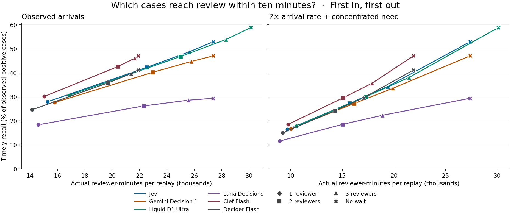

# When does a flag reach a human in time? Full MindGuard pilot

**The model, the staffing schedule, and the dispatch rule do different jobs.** In this replay,
doubling on-duty staffing from one to two reviewers recovered far more timely reviews than
reordering the same queue. Moving an existing shift to a predicted busy period helped all
six models without adding scheduled hours. Neither finding tells a real clinical
service how many people to employ.

**Collection, 2026-11-20:** six detectors × 1,134 rated path-turns = **6,804 native
three-option vectors**, including 2,268 new study calls. No failed study calls,
no inferred scores and no silent route substitutions. Clef Flash on DeepInfra cost
$0.026323151 for study calls + $0.000989406 for four synthetic attempts (including
one rejected and cost-reconciled response). Decider Flash V1.2 on Perplexity cost
$0.013264610 + $0.000259330 for two synthetic checks. **Total newly billed:
$0.040836497** of the approved $0.10. Both routes enforced zero data retention and
no fallback; clinician votes stayed local. Remaining analyses use only cached scores.

## Which cases did we actually use?

All **67** maximal observed role-play paths in the [clinician-rated release](https://huggingface.co/datasets/swordhealth/MindGuard-testset/tree/1c082b67bc0a6574badc3bf4cbe3e12af130f606):
50 opening families, 1,134 rated path-turns (1,117 distinct text prefixes). No full path
was excluded for missing ratings. There are 22 unassessable positions inside 17 paths;
the release cannot establish what happened after the final observed prefix. The
separate synthetic training set is not clinician-rated evidence.

The desk takes either concern: at least two of three clinicians chose a non-safe category
on the turn. There are **42 observed positive turns in 17 conversations (16 families)**:
self-harm, 20 turns in 9 conversations; harm to others, 22 in 8. The denominator is
conversations, not turns. The first *observed* endorsement starts the 10-minute clock,
whether or not the model noticed it. Count the first review start only when the
prefix frozen at nomination was endorsed and review started in time. A premature
unsupported alert consumes the only ticket. An unrated position is neither scored nor assumed safe.
If every gap were positive there could be 33 positive paths, not 17; one known
positive path could also start one turn earlier. This stress case is not an imputation.

## What did we hold constant?

Five outer folds keep shared openings together. For each model, fit a logistic calibration
of its native sum of the two concern probabilities on training families. Use inner
out-of-fold predictions to choose the first-crossing threshold that maximizes timely
FIFO catches over the first 750 training starts per placement (one reviewer, 20-minute
reviews); ties favor fewer alerts that actually start review, then the higher threshold.
Freeze this gate for every dispatcher. The primary folds hold out **families**, not the
public traffic clock. Outcomes are the working panel's endorsements, not a clinical posterior.

Each outer fold replays whole held-out paths in a separate queue, balancing appearances
per path. We aggregate counts with weights proportional to held-out path counts, then
divide; the resulting counts can be fractional. Eight paired placements vary the
alignment of a path with traffic, not how many independent cases we have. The fitted-Q
dispatcher learns only on resampled training paths (12 exploratory episodes across
three arrival rates); it can choose among FIFO, highest calibrated risk and risk plus
waiting time. Simple comparators also include estimated loss of timely credit from
waiting. The best simple rule is selected on separate training simulations, not on
test performance. A dispatcher sees no future arrivals, endorsements or true deadline.

The nine demand scenarios are six using the [Open Up crisis-service arrival intervals](https://formative.jmir.org/2024/1/e46823/)
(steady, observed, and doubled rate, each with/without concentrating positive paths in
busy windows), a thinned Azure AI request episode, and the same 2,184 monitored starts
over a [BurstGPT](https://arxiv.org/abs/2401.17644) week under actual vs even spacing.
The need-pulse construction swaps whole paths, preserving their exact multiplicities.
Only timing is observed. No historical service visitor or AI request is linked to
a MindGuard label. One, two and three simultaneous reviewers and an immediate-service
control share the same draws. Two minutes per user turn, twenty minutes per nonpreemptive
review, and ten minutes to start are assumptions, not measured requirements.

## Main results: detection and capacity before dispatch

Percent of observed-positive conversations getting a timely supported start under
**FIFO with a training-tuned threshold**. All models see identical simulated traffic.
Equal staffing does **not** guarantee equal work performed.

| Detector | Observed: 1 reviewer | 2 | 3 | No wait | Doubled load + need pulse: 1 |
|---|---:|---:|---:|---:|---:|
| Jev | 28.0% | 42.3% | 48.7% | 52.9% | 16.4% |
| Gemini Decision 1 | 27.7% | 40.2% | 44.8% | 47.1% | 16.7% |
| Liquid D1 Ultra | 30.6% | 46.8% | 53.9% | 58.8% | 17.9% |
| OpenAI Luna Decisions | 18.4% | 26.2% | 28.6% | 29.4% | 11.6% |
| Clef Flash | 30.2% | 42.6% | 46.1% | 47.1% | 18.6% |
| Perplexity Decider Flash | 24.7% | 35.8% | 39.7% | 41.2% | 15.1% |



For **detector** comparisons at exactly the same work, cap each FIFO at the smallest
realized number of starts across detectors **on that fold and placement**. With six
detectors on the observed one-reviewer trace this is 5,971 actual minutes on average:
**Clef 12.2%, Decider 12.0%, Jev 10.4%, Liquid 10.3%, Gemini 9.6%, Luna 4.8%.**
The tuned gate gave **zero common starts in three of five folds**. At the liberal
gates all folds contributed and the common budget rose to 25,737 minutes: Clef
22.0%, Decider 20.1%, Jev 19.3%, Luna 19.2%, Gemini and Liquid 12.7%. The
Clef–Decider liberal-gate difference (+1.94 points) varied from −3.81 to +5.31
points on omitting one fold. The [original four-detector comparison](figures/full-panel-four-crosswork.json)
had a different common tuned budget (9,748 minutes): adding a detector can shrink
the budget for *every* arm. No stable model ranking follows. This retrospective cap
can end service early; it is not a proposed shift policy or a shared prespecified budget.

For **dispatch**, match the first K starts of every rule within the same detector,
gate, staffing, fold and placement. The column below is the learned rule minus its
comparator in **percentage points**, not relative percent. Actual minutes are averaged
over paired runs of the observed one-reviewer trace.

| Detector | Matched reviewer-minutes | RL − FIFO | RL − training-selected simple rule | Hindsight ceiling at this staffing¹ |
|---|---:|---:|---:|---:|
| Jev | 15,277 | +0.03 | −0.60 | 30.7% |
| Gemini Decision 1 | 15,798 | +0.37 | +0.29 | 30.5% |
| Liquid D1 Ultra | 16,843 | +0.34 | +0.18 | 33.6% |
| Luna Decisions | 14,601 | 0.00 | 0.00 | 18.4% |
| Clef Flash | 15,035 | −0.11 | −0.32 | 31.2% |
| Perplexity Decider Flash | 14,156 | +0.20 | +0.02 | 27.0% |

¹ Uncapped, same tickets and staffing; hindsight can skip, idle, and know labels,
arrivals and onset. The code brackets the optimum using feasible schedules and a
relaxation, exact on small components. The table uses the upper bound; do not describe
the bound as an achievable policy. For Jev, immediate recall was 52.9%, the one-reviewer
ceiling was 30.7%, and FIFO got 28.0%: **47.1 points** lost before queueing, **at least
22.2** to capacity, **at most 2.7** available to better ordering *and* better information.
Some queues therefore matter a great deal without offering much useful choice to RL.

## What changes the answer?

All nine demand scenarios, illustrated with Liquid and the same tuned FIFO detector.
Read across a row for the effect of additional capacity; compare the steady and
observed rows within a trace for the effect of timing. Different source clocks do
not have the same session count or observation horizon.

| Arrival and need pattern | 1 reviewer | 2 reviewers |
|---|---:|---:|
| Even Open Up arrivals | 34.9% | 52.2% |
| Even arrivals + need pulse | 34.2% | 51.2% |
| Observed Open Up arrivals | 30.6% | 46.8% |
| Observed arrivals + need pulse | 26.3% | 40.1% |
| Double arrival rate | 20.2% | 35.5% |
| Double arrival rate + need pulse | 17.9% | 30.1% |
| Short Azure episode (60 monitored starts) | 13.1% | 26.1% |
| Evenly spaced BurstGPT week | 34.3% | 51.6% |
| Trace-timed BurstGPT week | 26.3% | 42.0% |

- **When need arrives:** For Liquid with one reviewer, FIFO caught 21.0% in the
  observed high-volume windows and 33.4% off peak. Under doubled rate and concentrated
  need, it caught **6.9% at peak vs 26.6% off peak**. On a different clock, Gemini RL
  caught 31.2% on evenly spaced BurstGPT-week arrivals and 24.6% on the thinned actual
  week. Same number of starts offered; different collision pattern.
- **When reviewers work:** One continuous reviewer plus one 8-hour shift per day means
  448 scheduled hours across the 14 scored days. Using the first 14 days' arrivals to
  place that shift, with a warm-up day before scoring and a follow-through day after,
  moved it from fixed 09–17 to predicted 18–02 (trace-relative, not known local hours).
  On days 16–29 (4,378 arrivals), FIFO recall with thresholds trained only on early
  traffic rose **32.1→35.3% Jev; 33.8→37.6% Gemini; 35.1→38.9% Liquid; 20.4→22.7% Luna;
  33.4→37.1% Clef; 27.4→30.7% Decider**.
  Both arms had the same scheduled hours, not the same busy minutes or overtime.
- **How long service takes:** With one reviewer on observed arrivals, 10 / 20 / 40-minute
  service yielded 40.1 / 28.0 / 18.2% for Jev and 44.4 / 30.6 / 19.6% for Liquid
  under FIFO. The alert threshold is held fixed; only the simulated service changes.
- **Whether sensitivity helps:** Locking a more liberal 0.10 calibrated gate for every
  model almost doubled Liquid's work (16,843→30,178 actual minutes with one reviewer);
  FIFO recall **fell** from 30.6% to 14.4%. Even with no wait, Liquid caught only 29.4%
  against 58.8% at its tuned gate. Under the single-ticket rule an early unsupported
  prefix can displace the later supported one. Luna went in the opposite direction:
  its one-reviewer FIFO recall rose from 18.4% to 19.9% at greater effort. This is
  reason to test alert updating, not a general argument for lower sensitivity.
- **Who competes with whom:** Mixing all 67 out-of-fold-scored paths in one queue per
  placement instead of isolating test folds gives one-reviewer observed FIFO recall
  of 33.8% Jev, 30.8% Gemini, 35.5% Liquid, 20.2% Luna, 32.8% Clef and 28.1% Decider. Queue composition matters.
  We do not evaluate an RL policy trained on part of that same mixed waiting room.
- **How rare is need?** Separately resample complete paths within positive and
  observed-negative strata on the same 9,175 observed arrivals. At source mix, 5% and
  1% simulated need (2,328 / 459 / 92 positive sessions), Liquid's one-reviewer FIFO
  recall was 35.9 / 50.8 / 55.0%; its no-wait ceiling stayed near 59%. Actual review
  minutes fell from 20,055 to 7,875 to 4,435. Yet the share of tickets **unsupported
  at the flagged turn** rose from 9% to 39% to 77%. Across the original four models at
  1%, 77–88% of tickets were unsupported. All four flagged the same one of 50
  observed-negative source paths; its repetitions account for roughly 182
  never-endorsed-path tickets per stream. **The two new detectors behaved differently:**
  neither flagged any of those 50 negative paths. At 1%, Decider generated 12.8%
  unsupported tickets (wrong turns on positive paths); Clef generated none but also
  only flagged eight distinct positive source conversations at the tuned gate.
  Across all six models fewer than 0.5% of starts were contested at 1%. These figures
  expose base-rate sensitivity; they are not estimates of a production false-alarm
  rate. This experiment fixes counts within each stratum, so its source-mix
  placement is not the identical draw used in the pooled-queue check above.

## Are the detectors making the same mistakes?

Before queueing, at their tuned gate, Liquid caught **10/17** distinct observed-positive
paths, Jev **9/17**, Gemini and Clef **8/17** each, Decider **7/17**, Luna **5/17**.
The original four jointly missed four; Clef caught one of those, so **three paths
were missed by all six**. The resulting 14/17 hindsight union is not deployable ensemble recall.
Jev and Liquid shared **7 misses**, versus 3.29 under marginal independence (φ = 0.89);
Gemini and Jev shared **7**, versus 4.24 (φ = 0.65). Luna and Liquid shared **5**,
versus 4.94 (φ = 0.02). Clef and Liquid shared five vs 3.71 expected (φ = 0.31);
Decider's seven catches were a subset of Liquid's ten. The original four falsely nominated the same one of the 50 paths with
no *observed* majority endorsement. These are descriptive, paired case counts, not
evidence of conditional independence given a latent risk state and not thousands of independent errors.

Across 1,134 rated turns the held-out Brier loss improved from native to calibrated:
Jev .0368→.0148; Gemini .0760→.0160; Liquid .0546→.0175; Luna .0674→.0217; Clef
.0514→.0226; Decider .0238→.0225 (training-prevalence reference .0358). Native
average precision: .783, .796, .768, .524, .632 and .630,
respectively. Better average calibration is not sufficient for timely access at a
particular operating point, and majority votes are not calibrated clinician posteriors.

## Reproduce or extend

[Primary operating points](figures/full-panel-tuned.json) and [liberal-gate operating
points](figures/full-panel-liberal.json) are aggregate only. See also [matched work at tuned](figures/full-panel-crosswork.json)
and [liberal gates](figures/full-panel-crosswork-liberal.json), [shifts](figures/full-panel-shifts.json),
[prevalence](figures/full-panel-prevalence.json) and [unique-case errors](figures/full-panel-errors.json).
The [FIFO sensitivity export](figures/full-panel-sensitivities.json) gives the six
Open Up clock variants at 10- and 40-minute service and all nine pooled-queue variants
at 20 minutes, for every detector and staff count.
In the column-oriented
schema, zip `columns` with each row. Reviewer count 0 denotes **immediate service**,
not an unstaffed desk. See the [design](timely-human-review-draft.md) and
[route contract, costs and canaries](providers.md). From the repository root with
private licensed inputs and the original public trace files:

```sh
D=benchmarks/mindguard/private
python -m benchmarks.mindguard.full_replay --annotations "$D/mindguard.parquet" \
  --caches "$D/responses.jsonl" "$D/luna-responses.jsonl" \
           "$D/clef-flash-responses.jsonl" "$D/decider-flash-responses.jsonl" \
  --trace "$D/real_interarrivals_nov.csv" --azure "$D/azure_conv_2023.csv" \
  --burst-week "$D/BurstGPT_1_v1.1.csv" --jobs 4 --out "$D/results-new.json"
```

Use `--gate liberal`, `--service 10`, `--service 40` or `--mixed-only` with fresh
output filenames. The sibling modules `full_crosswork`, `full_shifts` and
`full_discrimination` reproduce the exact across-model minutes, shift and unique-case
analyses; `full_prevalence` reproduces the fixed-prevalence sensitivity. Only
complete model cohorts may join the main panel. All six met this requirement.

**What this supports:** a mechanism study of time-sensitive access under scarcity,
not a claim that RL generally wins, a staffing recommendation, or evidence of prevented
harm. Next test renewable/updated tickets, variable service requirements and delays,
and repeat with independent review cases and a separate customer-support handoff
workload. More permutations cannot substitute for more independently annotated families.
