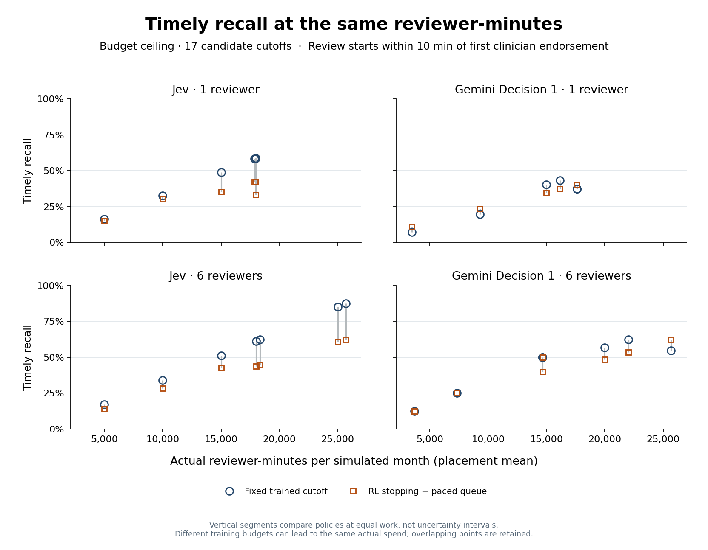

# Does learned stopping beat a trained fixed cutoff at the same workload?

**Not consistently in this pilot.** With one reviewer and exactly 15,000 reviewer-minutes per simulated month (750 review starts), the fixed cutoff beat RL for both Jev (48.9% vs 35.3% timely recall) and Gemini Decision 1 (40.3% vs 34.8%). Both methods exhausted this budget on every held-out placement. Across all ten model/staff/cap combinations that both policies fully spent on every placement, fixed won all ten. The comparisons reuse the same source cases; they are not ten independent experiments.



## How to read the comparison

- **Reference:** nominate a turn with majority self-harm endorsement and start its review within 10 minutes of the **first** majority-endorsed turn in that conversation. A later endorsement cannot reset this clock. There is at most one ticket per conversation. Every ever-endorsed dialogue arrival remains in the denominator, even if it arrives after the monthly budget is exhausted.
- **Workload:** each review that starts consumes 20 service minutes. One and six continuously available reviewers are separate scenarios on the same pinned 9,175-arrival trace. These are actual minutes *consumed inside the simulation*, not observed human work. The assumed two-minute user-turn cadence and deterministic service are unchanged from the [staffing replay](staffing.md).
- **Learning:** for each model, staffing level and budget (5k, 10k, 15k, 18k, 20k, 25k, 30k minutes), tune both cutoffs on training conversations only. Within each of five outer folds, obtain three-fold out-of-fold training scores with shared-opening families kept together. Replay the training cases on two seeded placements. Over 17 candidate cutoffs pick the one maximizing total on-time catches in the first budgeted starts; ties favor less work, then the higher cutoff. Refit the forecaster/stopping model on all outer training cases, freeze the cutoff, and apply to held-out paths. The primary treats a budget as a ceiling, not a requirement to use it all. The original observed traffic clock is shared between training and evaluation; these are new placements and families, not independently held-out service months.
- **Policies:** fixed is a calibrated current-turn probability cutoff with FIFO service. RL is a learned advantage of stopping now versus waiting, followed by the prior congestion-sensitive admission/priority rule. A secondary comparison puts the stopping score through the same FIFO rule as fixed, removing both the congestion surcharge and priority dispatch. The RL value function itself was not retrained to optimize the onset deadline or monthly expenditure: the **cutoff** on that value was tuned for timely catches under the cap.
- **Held-out evaluation:** compare the policies on the same eight balanced assignments of the original 50 dialogues to arrival times. For an announced cap of `B` starts, if the policies would start `N_fixed` and `N_RL` reviews, score their **first** `min(B, N_fixed, N_RL)` starts each, in actual dispatch order. No case is reordered; no test label decides where to truncate. This matches minutes *within every placement*, not merely on average. It does not make policies start reviews at the same times. The common count when one method underspends is a retrospective comparison, **not a deployable budget chosen in advance**. The JSON also reports each frozen policy independently under just the announced cap, its workload, and whether both filled it. The policies do not dynamically ration a remaining monthly allowance.

## What changes with the comparator?

Each cell is **mean minutes actually used by each policy · fixed recall / RL recall (%)**. The same original dialogues contribute to every row. Different targeted ceilings may produce the same point.

| Announced ceiling, min | Jev · 1 reviewer | Gemini · 1 reviewer | Jev · 6 reviewers | Gemini · 6 reviewers |
|---:|---:|---:|---:|---:|
| 5,000 | 5,000 · 16.4 / 15.3 | 3,460 · 7.3 / 11.1 | 5,000 · 17.0 / 14.2 | 3,670 · 12.5 / 12.5 |
| 10,000 | 10,000 · 32.7 / 30.4 | 9,290 · 19.6 / 23.5 | 10,000 · 34.1 / 28.4 | 7,332.5 · 25.0 / 25.0 |
| 15,000 | 15,000 · 48.9 / 35.3 | 15,000 · 40.3 / 34.8 | 15,000 · 51.1 / 42.7 | 14,675 · 50.0 / 50.0 |
| 18,000 | 17,867.5 · 58.4 / 42.0 | 16,137.5 · 43.4 / 37.4 | 18,000 · 61.3 / 43.9 | 14,675 · 50.0 / 40.0 |
| 20,000 | 17,972.5 · 58.8 / 42.2 | 17,625 · 37.4 / 40.0 | 18,345 · 62.5 / 44.7 | 20,000 · 56.7 / 48.5 |
| 25,000 | 17,972.5 · 58.8 / 42.2 | 17,625 · 37.4 / 40.0 | 25,000 · 85.1 / 60.9 | 22,017.5 · 62.5 / 53.6 |
| 30,000 | 17,972.5 · 58.8 / 33.1 | 17,625 · 37.4 / 40.0 | 25,685 · 87.5 / 62.5 | 25,687.5 · 54.7 / 62.5 |

Jev's trained fixed threshold had higher paired recall at all seven ceilings at both staffing levels. For Gemini the ordering changes. With one reviewer and a 10,000-minute ceiling the methods averaged 9,290 matched minutes; RL caught 23.5% and fixed 19.6%. At 15,000 minutes, fixed won. At six reviewers and a 30,000-minute ceiling, RL caught 62.5% vs fixed 54.7% at 25,688 matched minutes; independently using their own allocations, **both** caught 62.5%, with fixed using more minutes. Different caps can select different operating points even when realized minutes coincide; the plotted points are not an optimized frontier.

Only eight source dialogues, spanning seven opening families, have an endorsed turn (18 of 742 fully rated turns). For every positive Gemini RL difference in the primary comparison, omitting the scored outcomes of one positive family could reverse its sign. This diagnostic holds predictions, visits, queue states and the matched stop fixed; it is **not** a confidence interval. In contrast, at the one-reviewer, 15,000-minute point, omitting any single positive family still favored fixed for both models. Using the same FIFO admission and dispatch for both methods also favored fixed there (Jev by 12.9 points; Gemini by 5.9). No patient harms or interventions were observed.

**Cutoff-grid sensitivity (exploratory).** To check whether the few positive RL differences depended on coarse tuning, rerun *both* policies with 60 candidate cutoffs including more near zero; selection still uses training data only. With a budget ceiling, the 17-cutoff comparison favors fixed in 19 cells and RL in 6, with 3 ties; with 60 candidates fixed leads in 22 and ties in 6, with no RL leads. These are paired within-grid comparisons at realized work; changing the grid can change the workload as well as the threshold. At the 15,000-minute cap and one reviewer, Jev's finer-grid comparison was 45.4% vs 36.0% at 14,092.5 minutes; Gemini's was 36.4% vs 30.9% at 14,117.5 minutes. See the [finer-grid figure](figures/onset-budget-dense.png). More candidates are not automatically better and this is not external validation.

**Quota sensitivity.** If training must fill the available budget whenever feasible, both models favor RL at high quotas with one reviewer on the 17-cutoff grid. At 30,000 minutes, fixed selects cutoff zero in all five folds: every dialogue spends its only ticket on its opening turn. Fixed catches none on this endpoint; RL catches 20.6% (Jev) and 16.4% (Gemini). On the finer grid that high-quota reversal persists: 0% fixed for both, versus 31.2% and 23.9% RL, respectively. This is a different objective from making the best use of *up to* 30,000 minutes.

## Reproduce without any model calls

Using the same authorized, private local inputs as the [staffing study](staffing.md):

```sh
python -m benchmarks.mindguard.budget_replay \
  --annotations benchmarks/mindguard/private/mindguard.parquet \
  --responses benchmarks/mindguard/private/responses.jsonl \
  --trace benchmarks/mindguard/private/real_interarrivals_nov.csv \
  --jobs 4 > benchmarks/mindguard/private/onset-ceiling.json
python -m benchmarks.mindguard.budget_plot \
  --report benchmarks/mindguard/private/onset-ceiling.json \
  --out benchmarks/mindguard/private/onset-figure.png
```

Use `--require-fill` to reproduce quota tuning and `--dense-grid` for the finer-cutoff sensitivity. Write each JSON to a distinct path. The plot takes only aggregate JSON and requires matplotlib. No OpenRouter credentials or Luna receipts are used. Replay uses five fitted outer models mixed on held-out traffic; all thresholds and spending conventions must be frozen again on independent cases before making a production performance claim.
