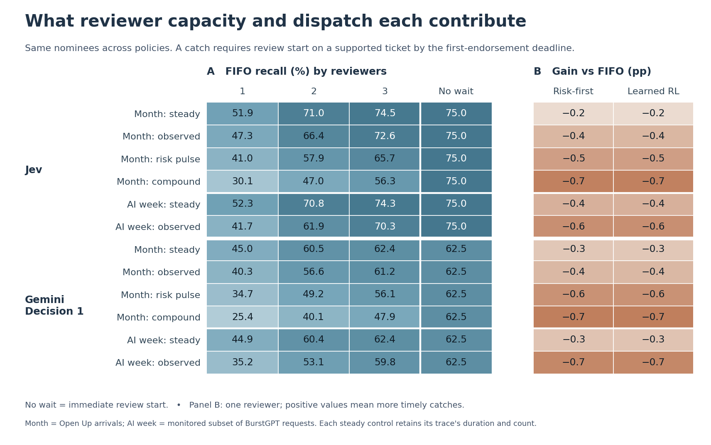

# When does a safety flag become a timely human review?

An alert that sits in a queue past its deadline is not a timely review. This offline pilot asks: **with the same detector and the same incoming tickets, how many missed reviews are due to late or incorrect alerts, how many are due to waiting, and how much can a different dispatch rule recover?** The outcome is a reviewer *starting* on a clinician-endorsed self-harm turn in a role-play, not a diagnosis, completed review, intervention or harm prevented.

## A real AI week, with a simulated safety desk

The table shows timely recall (%) with first-in, first-out dispatch (FIFO). “No wait” starts every nominated ticket immediately, but cannot repair a missed or incorrect nomination. Reviewers are **simultaneously on duty**, not total employee headcount. Staffing is fixed throughout each simulation; everyone takes 20 minutes per review. Each within-clock comparison uses the same conversations, with both labels and model scores kept intact.

| Arrivals and case mix | Jev: 1 / 2 / 3 / no wait | Gemini Decision 1: 1 / 2 / 3 / no wait |
|---|---:|---:|
| AI week, evenly spaced | 52.3 / 70.8 / 74.3 / 75.0 | 44.9 / 60.4 / 62.4 / 62.5 |
| AI week, original request times | 41.7 / 61.9 / 70.3 / 75.0 | 35.2 / 53.1 / 59.8 / 62.5 |
| Crisis-service month, evenly spaced | 51.9 / 71.0 / 74.5 / 75.0 | 45.0 / 60.5 / 62.4 / 62.5 |
| Crisis-service month, original arrival times | 47.3 / 66.4 / 72.6 / 75.0 | 40.3 / 56.6 / 61.2 / 62.5 |
| Same month, higher need in busy windows | 41.0 / 57.9 / 65.7 / 75.0 | 34.7 / 49.2 / 56.1 / 62.5 |
| Twice the arrival rate, unchanged mix | 34.1 / 54.8 / 65.8 / 75.0 | 28.9 / 47.4 / 56.8 / 62.5 |
| Twice the rate **and** higher need in busy windows | 30.1 / 47.0 / 56.3 / 75.0 | 25.4 / 40.1 / 47.9 / 62.5 |

On the AI week, changing only the timing cost one reviewer **10.6 points of Jev recall and 9.7 points of Gemini recall**. The offered work was only about 0.52 reviewer-equivalents averaged across the week. Under observed timing one reviewer was busy about 31% of the week, yet missed about a third (Jev) or a quarter (Gemini) of all positive sessions specifically to queue delay. Idle time overnight cannot be spent on an expired afternoon ticket. In the compound monthly stress, one-reviewer recall in busy vs other windows was **13.5% vs 43.3%** for Jev and **10.5% vs 37.4%** for Gemini. “Busy” refers to the session's arrival window, not when a flag or a review occurred.



Public operating points for the [tuned gate](figures/surge-review.json) and the [more sensitive gate](figures/surge-review-liberal.json) cover all nine clock and mix conditions, both models, and all policies, including the short Azure burst and the steady-clock risk pulse. These are simulated operating characteristics, not clinical performance estimates.

## What did queue RL actually add?

This is a different action from the [earlier within-dialogue stopping experiment](onset-budget.md): the gate is frozen, and the learner can only select the **next waiting ticket**. The comparators are FIFO, highest current calibrated score, and score with an age bonus (up to 0.10). All are nonpreemptive and start work when a reviewer is free. Without a contested start there is no dispatch choice; all rules must tie if every ticket starts immediately. With one waiting ticket and no free reviewer, delay can still cause a miss that **no ordering rule** can avert.

At the training-selected gate, the frozen learner chose exactly the same tickets as highest-score-first in all 54 finite-staff conditions (2 models × 9 workloads × 3 teams). Neither beat FIFO on total timely recall. On the AI week with one reviewer, switching from FIFO to RL changed Jev by −0.63 points and Gemini by −0.67. On the observed crisis-service month the change was −0.38 for both, at identical actual minutes within model (14,706 for Jev, 14,710 for Gemini, averaged and rounded). Other staffing contrasts hold capacity fixed, not necessarily actual starts/minutes.

Why so little learning signal? Only six distinct held-out conversations per model nominated a ticket; each isolated fold offered zero, one or two distinct nominated paths, sometimes many copies of the same ticket. Across 30 primary training fits, only 1,647 of 66,650 starts offered genuinely different choices among the rules. Twenty-three fitted state entries preferred something other than score priority, but none changed a held-out decision. An estimated probability describes the ticket's content, not whether a scarce slot can still rescue it. These are reasons to measure decision opportunities and include simple baselines, **not** evidence that FIFO is optimal.

Three checks qualify this result:

1. **Change the time a review occupies a reviewer.** At ten minutes per review, FIFO on the AI week with one reviewer catches 59.4% (Jev) and 50.5% (Gemini); at forty minutes, 26.9% and 23.0%. At neither duration did RL beat FIFO in any of the 54 cells. These durations are scenarios, not measurements.
2. **Change detector sensitivity.** Replacing the tuned cutoffs (0.40–0.80) with 0.10 produces more tickets and changes which turn spends the conversation's only chance at review. RL now beats FIFO in 48 of 54 cells. For one reviewer under compound stress, FIFO / score-first / RL is 25.3 / 27.2 / 27.1% for Jev and 18.6 / 19.0 / 19.5% for Gemini. A simple rule captures much of that gain; neither liberal-gate RL result reaches the tuned-gate FIFO result. Even instantaneous service now reaches only 62.5% / 50.0% because more one-shot alerts are spent on the wrong turn. Thus a more sensitive trigger is not necessarily a more sensitive *service*.
3. **Let all 50 conversation paths compete in one queue.** Pool the same frozen, out-of-fold nominations and rerun the nonlearned rules. On the AI week with one reviewer, FIFO / score-first is 46.81 / 46.17% (Jev) and 38.40 / 38.37% (Gemini); evenly spaced FIFO is 55.5 / 46.7% respectively. Mixing families changes the absolute recall but retains the cost of burstiness. It does not reveal a material score-priority advantage on either long trace. With only 60 arrivals per draw, the short Azure episode is more variable: Gemini score-first gains 5.06 points over FIFO with two reviewers. These scores compete across different calibration fits and are not a single prospective service. Do not apply an RL policy trained on any of the mixed queue's source paths.

## How the experiment works

- **Cases and gates.** Use the 50 completely rated MindGuard role-play conversations (742 user turns). Eighteen turns in eight conversations across seven opening families have a majority self-harm vote. Group outer folds by opening family. Fit the single-model calibrator on training families; choose a fixed first-crossing threshold using inner out-of-fold training scores and the prior study's one-reviewer, 15,000-minute ceiling criterion. Freeze those thresholds across all stress conditions. The ceiling is for gate selection only: this replay has no quota on how many reviews may start. Never show the queue a clinician label, future turn, or the peak tag.
- **Clock and credit.** Space user turns two minutes apart. Once per conversation, nominate the first turn crossing the threshold; do not award credit to an early unsupported nomination even if a later turn is endorsed. A catch requires majority endorsement on the nominated turn and review **start** within ten minutes of the **first** endorsed turn. Tickets expire after ten minutes *from nomination* because dispatch cannot observe true onset. Both deadlines include equality. Finish draining the queue after the last arrival. Turn cadence, ticket lifetime, service duration and staffing are assumptions.
- **Resampling and evaluation.** Within each outer holdout, balance and shuffle whole conversations across arrival slots (multiplicities differ by at most one). All policies receive the exact same tickets for that model, fold, clock and placement. Keep the five service queues separate so the trained dispatcher has never trained on any of its queue's source families. Across eight paired placements, pool counts with weights proportional to the number of distinct conversations in each holdout before dividing. Do not count resampled conversations as independent clinical evidence; the leave-one-fold ranges in the full local output are sensitivity diagnostics, not confidence intervals.
- **Demand.** Flatten arrival times without changing the monitored volume or endpoints for a steady comparator. In the monthly pulse arms, move positive paths into the busiest windows, targeting twice overall prevalence there subject to available cases. Swap whole paths, preserving *every path's count*. The doubled-rate clock compresses elapsed time and window width by two, never the service time, deadline or conversation cadence. Peaks are the busiest ceiling(10% of bins) of each unmodified source clock, including empty bins, with ties broken chronologically. They are retrospective evaluation strata, not a forecast given to the policy.
- **RL.** On training families only, simulate 12 Poisson episodes of 2,000 monitored sessions at 13, 26 or 52/hour. Explore uniformly among distinct tickets proposed by the three dispatch rules; decisions affect subsequent opportunities. Fit a tabular queue policy on batch transitions, maximizing discounted timely catches (0.98 per review started). The state describes queue depth, age, score gap and which rules differ. Require six visits per action and shrink returns toward pooled state means; use score priority outside supported states. Freeze the policy before evaluation. This restricted learner is neither an oracle nor an optimizer over all possible queue policies.

## What was measured, and what was simulated?

| Clock | Observed data | Simulation assumption |
|---|---|---|
| AI week: [Wang et al., BurstGPT](https://arxiv.org/abs/2401.17644), [v1.1 data](https://github.com/HPMLL/BurstGPT/releases/tag/v1.1) | First seven days of the pinned release: 19,120 conversational-mode request submissions, including failed requests; hourly counts range from 0 to 353. | Thin uniformly across the whole week to 2,184 monitored arrivals (13/hour on average, no hourly quotas). Original minute offsets are retained. The matched steady week uses the same 2,184 arrival slots and same paths. |
| Crisis-service month: [Chiang, Law & Yip](https://formative.jmir.org/2024/1/e46823/), [public interarrivals](https://github.com/cathug/crisis-des/blob/4fc679321b19bdff91d59f765537c86296cfa1fa/real_interarrivals_nov.csv) | 9,175 visitor interarrival intervals from Hong Kong's Open Up service in November 2020. The study describes staffing and a ten-minute wait target in that service. | Each visitor arrival is assigned a new simulated monitoring session. Neither that service's clients nor its counselors were scored by the decision models. |
| Short AI episode: [Azure Splitwise conversation trace](https://github.com/Azure/AzurePublicDataset/blob/790921015d50dd6aae7f7e47f39ba0e235ad6b08/data/AzureLLMInferenceTrace_conv.csv) | 19,366 model invocations over 58.36 minutes. | Thin to 60 monitored arrivals per placement on the native clock. This gives a short stress episode, **not** a representative week; peak analysis uses the busiest two of twelve five-minute bins. |

The two AI traces contain request arrivals, not unique users, review flags, reviewer rosters, or clinician-rated outcomes. The link between a timestamp and a review need is synthetic in **every** arm. The original Open Up clock also informed the earlier gate selection; the AI traces did not.

## A paper about human review, not an RL leaderboard

Let `P` be the number of conversations with any endorsed turn, `R∞` timely recall with instant service at the fixed gate, and `Rπ(c)` timely recall under dispatch rule π with c reviewers. The missed fraction partitions exactly:

```text
1 − Rπ(c)  =  (1 − R∞)  +  (R∞ − Rπ(c)).
               gate loss       queue delay loss
```

In the observed AI week, for example, Jev’s 58.3% missed with one reviewer breaks into 25.0% never nominated, 30.3% expired, and 2.9% started too late (rounding). For Gemini the 64.8% missed breaks into 25.0% never nominated, 12.5% wrong turn, 24.8% expired and 2.5% started too late. The no-wait ceiling is conditional on this gate and one-shot rule; it is not a limit on what a different detector could do. The difference between finite-team dispatch rules measures *recoverable by that change*, not all queue loss. Average offered load `(# tickets × minutes per review)/(reviewers × elapsed minutes)` describes demand pressure, not a guarantee of timely service.

[Lykouris & Weng, *Learning to Defer in Congested Systems*](https://arxiv.org/abs/2402.12237) separate classification, admission and scheduling, and formalize selective feedback. Our contribution to test is narrower: estimate **timely, onset-anchored human-review recall** in multi-turn systems; separate detection failures from waiting losses; and report how each changes with traffic shape, sensitivity and staffing. Do not claim a new globally optimal scheduler or patient benefit.

**Next study.** Before changing the production classifier, seek a privacy-preserving operations partner. Start with timestamped anonymous counts for arrivals, flags, service starts/ends, expirations, concurrent reviewers and shift changes; case text is unnecessary to validate queue dynamics. Estimate the distribution of service time, burst duration, within-conversation timing and review coverage rather than assuming constants. For inference on recall, independently audit a stratified probability sample of alerted **and non-alerted** sessions across quiet and busy periods. Pre-register deadlines and endpoints with reviewers, validate on untouched time blocks/organizations, and quantify uncertainty over case families and time blocks separately. In shadow replay compare constant staffing with staggered breaks and peak overlap at **equal scheduled staff-hours**, then ask if learning adds anything over FIFO or a simple deadline-aware rule. Only a separate study of reviewer decisions and downstream outcomes could address whether a human intervention helped.

## Reproduction (offline; no model credentials)

Use the authorized annotations and cached scores documented in the [pilot](README.md), the pinned [monthly trace](staffing.md), and the two public timestamp files above (BurstGPT release asset `BurstGPT_1.csv`, Azure `AzureLLMInferenceTrace_conv.csv`). Keep inputs in the git-ignored private directory. Loaders check file digests.

```sh
python -m benchmarks.mindguard.surge_replay \
  --annotations benchmarks/mindguard/private/mindguard.parquet \
  --responses benchmarks/mindguard/private/responses.jsonl \
  --trace benchmarks/mindguard/private/real_interarrivals_nov.csv \
  --azure benchmarks/mindguard/private/azure_conv_2023.csv \
  --burst-week benchmarks/mindguard/private/BurstGPT_1_v1.1.csv \
  --jobs 4 > benchmarks/mindguard/private/surge-week-primary.json
python -m benchmarks.mindguard.surge_results benchmarks/mindguard/private/surge-week-primary.json \
  > benchmarks/mindguard/private/public-points.json
python -m benchmarks.mindguard.surge_plot --report benchmarks/mindguard/figures/surge-review.json \
  --out benchmarks/mindguard/private/replicated-figure.png
```

Use `--service 10`, `--service 40`, or `--gate liberal` (fixed 0.10) as separate sensitivities; write each report to a new file. For the shared-queue check, replace `surge_replay` with `surge_mixed`, keep the same input flags, and set `--jobs 2` and a different output path. The figure and public points contain aggregates only and can be used without gated data.
