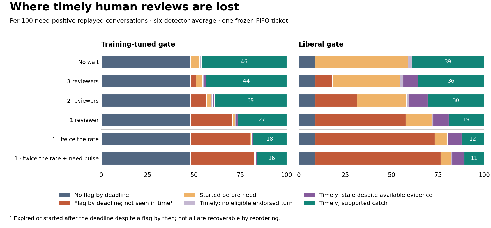

# Can a later turn rescue a ticket that is already waiting?

**Result:** yes, particularly when the alerting threshold is sensitive. On the
observed arrival clock with one reviewer, updating at the liberal gate increased
timely supported recall for all six detectors. At the training-tuned gates, only
Gemini and Luna had any recoverable cases. This changes what a reviewer sees,
not who reaches a reviewer or when. [Results and actual minutes](#results).

## Estimand and design, before running the pilot

Keep the full-cohort MindGuard experiment's first threshold crossing, FIFO position,
expiry, 20-minute service time and first-observed-need clock. An alert opens once.
While it waits, its presentation can change: at the instant of review the reviewer
gets one prefix ending at a selected observed turn, not multiple tickets. A turn
arriving exactly at review start is visible; one arriving later is not. A handled
or expired alert cannot be reopened. Updates incur no additional reading time in
this experiment. Test that assumption separately before extrapolating to real teams.

Let $Y_{ij}$ be the observed majority either-risk endorsement at turn $j$,
$T_i$ its first occurrence, $r_i$ the first alert, and $s_i$ the service start
(infinite if never served). Use minutes on the conversation clock. At a finite
start, the allowable prefix endpoints $V_i(s_i)$ are the rated turns observed
from the alert through $s_i$. Policy $a$ selects $j_a$ from those turns without
seeing endorsements. With $I_i=1\{T_i\le s_i\le T_i+10\}$ for observed-positive,
served paths (zero otherwise), the paired effect is

$$
R_a-R_0 =
\frac{\sum_i I_i(Y_{i,j_a}-Y_{i,j_0})}{\#\{i:T_i<\infty\}}
= \frac{\text{frozen misses rescued}-\text{frozen catches spoiled}}
       {\text{observed-positive sessions}} .
$$

Here $j_0$ is the original flagged turn. Use the original fold weights for pooled
counts. Every arm shares the *same start for the same session*, not just a matching
total. Actual work is therefore identical: 20 minutes per start. Changing the
turn cannot get a human there earlier. It can improve or damage the match between
the evidence presented and a timely human start. If nothing else arrives before
the start, even a label-aware selector cannot improve the frozen ticket.

### Two ways to use Bayes' rule

The six models already saw the conversation history when they scored each new
prefix. Multiplying their successive posterior odds as if they came from
independent observations would count the same text repeatedly.
This is the information-overlap distinction in [Satopää et al.](https://arxiv.org/abs/1505.06472);
we do not assume their forecast-aggregation model applies to clinical conversations.

1. **Filter current evidence.** For one detector, let $q_t$ be its development-
   calibrated probability of majority endorsement on the *current* turn and
   $b_t$ its score bin. Model the endorsement state as transient, not absorbing.
   Write $A_y=P(Y_t=1\mid Y_{t-1}=y)$ and
   $e_y=P(b_t\mid b_{t-1},Y_t=y)$. The filter predicts
   $u_t=A_0(1-p_{t-1})+A_1p_{t-1}$, then updates:

   $$
   p_t=\frac{u_t e_1}{u_t e_1+(1-u_t)e_0}.
   $$

   The likelihood uses the observed *score transition*, not the marginal
   likelihood for a second independent alert. This is a first-order
   approximation (compare [Hamilton's regime-switching filter](https://doi.org/10.2307/1912559)),
   not an identity for arbitrary nested LLM inputs. Shrink estimates from sparse
   training counts; initialize or restart from $q_t$ after an unobserved turn.
   Highlight the turn with the largest forward-filtered $p_j$ since alert;
   a tie keeps the earlier evidence. This ranks archived probabilities as they
   stood at each turn; it does not retroactively smooth old states or claim to
   minimize the deadline loss.
2. **Decide whether to switch the displayed evidence.** The quantity that matters
   at a specific start is instead
   $E[I_i(Y_{ik}-Y_{ij_0})\mid\text{visible scores, ticket age}]$ for a later
   candidate $k$. A gain occurs only for a timely new-only endorsement; a loss
   only for a timely original-only endorsement. Estimate their relative
   frequencies from training paths with prior shrinkage rather than multiplying
   marginal scores. Keep the original unless the estimated gain is positive.
   This is a working posterior for this decision under our data-generating
   assumptions, not a clinician's personal posterior or the effect of an intervention.

For rule 1 we fix bin edges at 0.10, 0.50 and 0.80. The two state-transition rows
shrink toward training prevalence (two pseudo-observations); the emission rows
shrink toward the pooled score transitions for that previous bin (four).
For rule 2 the challenger is the highest calibrated score among *later* visible
turns, earliest on ties. Compare it only with the original, not a sequence of
previous winners. Use three pre-specified cells for the challenger/original
calibrated-odds ratio: below 1/2, 1/2 through 2, above 2. In each cell the
posterior mean payoff difference is proportional to
$(n_{\rm gain}+0.50)-(n_{\rm loss}+0.75)$; the two other outcome categories
each start at 0.50. Thus a lack of training evidence favors keeping the original.
The counts are weighted over development landmark comparisons; each opening
family contributes at most one unit. Development considers ages 0 through 10
minutes at one-minute increments, omitting those without a visible challenger;
the learned odds-ratio cell averages over these landmarks, not a fitted wait-time
distribution. The paired table follows the algebra of [Lin et al.](https://pmc.ncbi.nlm.nih.gov/articles/PMC2720576/);
we do not use their missingness model or p-values. This fractional-count Dirichlet update is
a working, weighted posterior, not a fully specified joint distribution of
clinician votes and queues. Neither rule uses evaluation labels to act.

Compare both against a frozen ticket, always showing the latest rated turn,
the latest turn above the admission threshold, and retaining the highest ordinary
calibrated score since alert. The label-aware upper bound can choose any supported
visible endpoint at the same starts. It is not a deployable rule. Report *all*
arms, with no evaluation-set choice of winner or operating point.

Primary comparison: historical Open Up arrivals, one reviewer, previously
training-tuned gate; repeat with the previously specified liberal 0.10 gate,
all nine demand scenarios, one/two/three reviewers and no wait. Five
opening-family-held-out folds and eight paired placements reproduce the earlier
experiment. Fit the new rules only on inner-out-of-fold training trajectories,
never on copies of evaluation paths. Report net changes, gross rescues and
losses, update opportunities, unique affected source cases, and sensitivity to
dropping a held-out fold. These are not confidence intervals based on thousands
of independent patients.

## Results

All six detectors, 1,134 rated path-turns, all 67 conversations (17 observed
positives, 16 positive opening families). No new model calls or annotations.
The 22 gaps in the source release were not scored or treated as negatives.
All **432** detector × gate × scenario × staffing conditions reproduced the
original FIFO counts and simulated work. At all 108 no-wait conditions every
presentation rule tied exactly. Review starts and durations come from a single
shared trace per comparison, not separate simulations adjusted to equal totals.

**Primary: previous training-tuned gate, observed arrivals, one reviewer.**
Baseline is recall in percent; changes are absolute percentage points. “Latest
qualifying” means the last available rated turn above the original alert
threshold. “Max” retains the highest calibrated score observed since alert,
keeping the earlier turn on ties. “Perfect selection” knows which *visible*
turns were endorsed but cannot change the start or see future turns.

| Detector | Actual reviewer-minutes | Frozen recall | Latest qualifying Δ | Max Δ | Filter Δ | Paired Bayes Δ | Perfect selection Δ |
|---|---:|---:|---:|---:|---:|---:|---:|
| Jev | 15,277 | 27.96% | 0 | 0 | 0 | 0 | 0 |
| Gemini Decision 1 | 15,798 | 27.66% | +1.05 | +1.05 | 0 | 0 | +1.05 |
| Liquid D1 Ultra | 16,843 | 30.64% | 0 | 0 | 0 | 0 | 0 |
| Clef Flash | 15,035 | 30.17% | −0.75 | 0 | 0 | 0 | 0 |
| Perplexity Decider Flash | 14,156 | 24.66% | 0 | 0 | 0 | 0 | 0 |
| OpenAI Luna Decisions | 14,601 | 18.39% | +4.93 | 0 | 0 | +4.93 | +4.93 |

Gemini's +1.05 came from **one** original positive path. Luna's paired rule
rescued **four** original paths from four families and spoiled none; timely
supported recall reached **23.31%** (deltas are calculated before rounding).
Those paths fell in one held-out fold: the gain ranged from 0 to +6.45 points
when omitting one fold from the pooled comparison. Simply showing the latest
still-qualifying turn matched the gain. Always showing the latest turn, with no
qualification, **reduced** recall on five of six models (−2.15 to −4.03 points).
The newest evidence is not necessarily the most useful evidence.

**Sensitivity: liberal gate 0.10, otherwise identical.** Every column within
a row still uses the exact same reviews. The minutes are *not* equal between
this table and the tuned table; do not infer that a liberal gate is better.

| Detector | Actual reviewer-minutes | Frozen recall | Latest qualifying Δ | Max Δ | Filter Δ | Paired Bayes Δ | Perfect selection Δ |
|---|---:|---:|---:|---:|---:|---:|---:|
| Jev | 27,726 | 20.47% | +3.28 | +7.89 | +4.65 | +7.89 | +8.35 |
| Gemini Decision 1 | 30,201 | 14.47% | +5.86 | +10.61 | +8.31 | +9.56 | +10.61 |
| Liquid D1 Ultra | 30,178 | 14.44% | +7.35 | +11.22 | +7.40 | +9.68 | +11.22 |
| Clef Flash | 27,680 | 22.93% | +0.38 | +4.04 | +1.71 | +4.04 | +5.96 |
| Perplexity Decider Flash | 29,090 | 23.27% | +2.76 | +4.45 | +1.51 | +4.01 | +5.42 |
| OpenAI Luna Decisions | 27,447 | 19.90% | +6.70 | +2.55 | +3.31 | +8.59 | +9.35 |

Three checks keep those percentages in perspective:

- **Enough time for a useful update?** With one reviewer, 22–38% of starts at the
  tuned gate and 38–45% at the liberal gate had a later rated turn visible.
  Visibility alone was not enough: at tuned Jev, Liquid, Clef and Decider, even
  perfect selection gained nothing. With liberal Liquid, 25.66% of positive
  cases already had a start in the onset window. Max-score selection moved
  supported recall from 14.44% to that **25.66% ceiling**: ten distinct positive
  paths were rescued in at least one placement and none spoiled. No previously
  unserved case got a reviewer. The tuned frozen gate still caught 30.64% with
  **fewer** minutes.
- **Whose cases changed?** With the liberal paired rule, Luna rescued seven
  distinct positive paths/families and spoiled none; its net gain remained
  +4.93 to +11.23 points on omitting one fold. Decider rescued five distinct
  paths and spoiled one. For example, its weighted average over resampled
  streams was 115.8 previously missed sessions rescued and 22.5 spoilt,
  a +4.01-point net gain on approximately 2,328 positive sessions per stream.
  These are repeated cases, not 138 independent clinical outcomes.
- **Does it survive changes in demand or staffing?** With the liberal gate, both
  max-score and paired Bayes beat frozen in all 162 finite-staff conditions
  (six detectors × nine demand patterns × three teams). With tuned gates the
  max-score rule gained only for Gemini; paired Bayes gained only for Luna.
  For Luna, the liberal paired gain on observed arrivals was +8.59 / +10.40 /
  +8.10 / 0 points for one / two / three / immediately available reviewers.
  There is no reason to delay a review to obtain a later turn.

The Bayesian *filter* is not the same intervention as the Bayesian *decision to
switch*. The filter worsened turn-weighted, held-out Brier loss on all six
detectors (e.g., Jev .0148→.0206, Gemini .0160→.0196). It gained nothing at
the tuned gates and did not establish an advantage over simpler rules. The
paired rule was more useful on liberal Luna but it was not a general winner.
The practical comparison is against max-score and latest qualifying, not just
against a deliberately frozen ticket.

### Was Luna's gain Bayesian, or just a tie?

**Exploratory, after seeing the primary result:** repeat observed arrivals with
one reviewer and change only the tie convention. When several visible turns
have the *exact same highest score*, show the latest of them instead of the
earliest. A lower score cannot displace a higher one. No parameters are fit.

- **Tuned Luna:** all four rescued source paths involved a later prefix with
  exactly the same calibrated score as the original. In fact **both native
  either-risk sums were exactly 1.00** in every such rescue: the tie was already
  present in the returned scores, not introduced by clipping or recalibration.
  Latest-on-maximum and the
  paired Bayesian rule had the same timely outcome on **every reviewed session**,
  even where the selected turns differed. Both gained +4.93 points.
- **Liberal Luna:** latest-on-maximum gained +8.37 points versus +8.59 for the
  paired Bayesian rule, a **0.21-point difference**, not the 6.04-point
  difference one would infer from an earliest-on-maximum comparator. The
  similar totals hide a trade-off: the latest-on-maximum rule rescued eight
  distinct paths but spoiled one; paired Bayes rescued seven and spoiled none.
- On the other five detectors at the liberal gate, latest-on-maximum gained
  +8.35 Jev, +10.61 Gemini, +11.22 Liquid, +4.04 Clef and +4.45 Decider.
  In this comparison, there is **no compelling evidence for the extra
  complexity of Bayes**. The tie convention deserves an independent test.

See the [tie diagnostic](figures/ticket-update-ties.json). This was a mechanism
check, not a pre-specified confirmation or a new tuning pass.

### Reproduce

The [aggregate report](figures/ticket-updates.json) gives unrounded paired
counts, rates, opportunity ceilings, unique affected path/family counts, fold
and placement sensitivities, and training diagnostics. `staff=0` means immediate
service. The [previous experiment](full-panel-findings.md) describes the clocks,
service assumptions, model pins and source permissions. From the repository root,
with the same local licensed inputs, cached responses and trace files:

```sh
D=benchmarks/mindguard/private
python -m benchmarks.mindguard.update_pilot --annotations "$D/mindguard.parquet" \
  --caches "$D/responses.jsonl" "$D/luna-responses.jsonl" "$D/clef-flash-responses.jsonl" "$D/decider-flash-responses.jsonl" \
  --trace "$D/real_interarrivals_nov.csv" --azure "$D/azure_conv_2023.csv" \
  --burst-week "$D/BurstGPT_1_v1.1.csv" --jobs 6 --out "$D/ticket-updates-new.json"
python -m benchmarks.mindguard.update_ties --annotations "$D/mindguard.parquet" \
  --caches "$D/responses.jsonl" "$D/luna-responses.jsonl" "$D/clef-flash-responses.jsonl" "$D/decider-flash-responses.jsonl" \
  --trace "$D/real_interarrivals_nov.csv" --primary "$D/ticket-updates-new.json" --out "$D/ticket-ties-new.json"
```

The run needs no provider key. Only aggregate outputs belong in git. The experiment
measures **whether the selected endpoint of the displayed prefix was endorsed**,
not whether a human would find other relevant evidence in the prefix, agree with
the alert, act differently, or take the same time to read an update. The next
validation is a blinded reviewer comparison of the two displays, measuring actual
review time and whether the reviewer identifies the supported evidence, on
independent conversations. Adding new tickets after service or retaining a ticket
beyond its expiry is a different intervention with a different workload.

## Where cases are lost and which fix buys the most catches

On the full cached replay, **a sensitive gate and an accurate alert are not enough**. With one reviewer, liberal gates flag almost every need-positive conversation, but many never reach a timely review. Training-tuned gates leave many more conversations unflagged, yet get more *supported* reviews per equal number of minutes. The tables below separate two questions: *where did cases go in the natural queue?* and *what changed when we gave competing policies exactly the same amount of work?* No new model calls or clinician ratings were collected.

### Where the cases went

Per 100 observed-positive replayed conversations, **before any retrospective work cap**, with a frozen ticket and FIFO. Each row averages the six detectors equally on the same arrivals; it is not a six-model ensemble. The clock is ten minutes from the first observed majority-endorsed turn. “Stale” means another eligible, already visible turn was endorsed at that timely pickup; “no eligible evidence” means none of the selectable *endpoints since nomination* was endorsed. Neither establishes what an actual human would notice in a full transcript.

| Gate / arrivals / reviewers | Never flagged | First flag too late | Flag by deadline, but expired or started late | Started before need | Timely, no eligible evidence | Timely, stale | Timely catch |
|---|---:|---:|---:|---:|---:|---:|---:|
| Tuned · observed · 3 | 48.0 | 0.0 | 3.0 | 3.5 | 0.9 | 0.9 | 43.6 |
| Tuned · observed · 2 | 48.0 | 0.0 | 8.6 | 2.4 | 0.7 | 1.2 | 39.0 |
| Tuned · observed · 1 | 48.0 | 0.0 | 22.8 | 1.2 | 0.4 | 1.0 | 26.6 |
| Tuned · doubled + need pulse · 1 | 48.0 | 0.0 | 34.5 | 0.4 | 0.2 | 0.7 | 16.1 |
| Liberal · observed · 3 | 3.9 | 4.9 | 9.2 | 36.4 | 1.7 | 8.0 | 35.8 |
| Liberal · observed · 2 | 3.9 | 4.9 | 22.5 | 26.6 | 1.3 | 10.2 | 30.5 |
| Liberal · observed · 1 | 3.9 | 4.9 | 48.8 | 13.9 | 0.7 | 8.5 | 19.3 |
| Liberal · doubled + need pulse · 1 | 3.9 | 4.9 | 67.5 | 5.9 | 0.4 | 6.6 | 10.8 |



These are allocations of misses, not claims about which intervention would rescue them. A one-shot ticket can start *before* the first observed evidence, or even expire before that evidence appears; it cannot be reopened in this experiment. Equally, a ticket can be stale only if it gets a timely pickup. As congestion worsens, fewer stale tickets **at pickup** can mean that more people were never seen. At the tuned gate on the observed clock with one reviewer, 20.9 per 100 positives were flagged but never served and 1.9 started after the deadline; at the liberal gate those figures were 50.7 and 3.0. The liberal numbers include 4.9 late first flags, so do not add them again.

The [432 operating points](figures/loss-audit.json) give the full decomposition in mean **case counts**, not just rates: all six detectors, nine demand scenarios, two gates and four staffing settings (including no wait). The observed-clock and doubled-clock comparisons have the same 9,175 arrivals and about 2,328 resampled need-positive episodes per placement after fold weighting. They come from **67 distinct role-plays, 17 observed-positive (16 opening families), 1,134 rated turns and 22 unrated positions**. The source clock is real; the assignments of conversations, reviewer labor and deadlines are simulated.

### Which fix wins at the same actual minutes?

For each detector, held-out fold, placement, arrival scenario and staffing level, replay both gates and both dispatchers. Let each queue work in chronological order and compare the **first K starts**, where K is the smallest realized start count of the four queues. Every presentation uses those exact starts for its queue. All 16 arms therefore spend exactly **20 × K** busy minutes in that block, including reviews of negative or premature alerts. All positive arrivals, including those after the cap, remain in the denominator. This is a retrospective work match, not a policy that knows its future budget. Minutes are matched **within**, not between, detectors or staffing levels. The tuned gate was selected on training families for timely FIFO catches with a cap on starts; the fixed liberal gate was not optimized for that objective.

One reviewer, observed clock: extra timely supported catches **per 100 positive arrivals**, relative to the *liberal gate, FIFO, frozen ticket*. Each column changes **one** decision. Refresh shows the highest calibrated score seen since nomination, using the most recent turn on an exact tie (an exploratory tie convention from the earlier pilot). “Priority” takes the highest-scored waiting alert rather than the oldest.

| Detector | Mean matched busy minutes | Tune gate only | Refresh only | Priority only |
|---|---:|---:|---:|---:|
| Jev | 15,277 | +19.3 | +5.8 | +1.8 |
| Gemini Decision 1 | 15,798 | +21.0 | +6.9 | +0.9 |
| Liquid D1 Ultra | 16,843 | +23.5 | +7.0 | +1.0 |
| Luna Decisions | 14,601 | +7.7 | +6.7 | +0.4 |
| Clef Flash | 15,035 | +15.6 | +1.8 | +0.9 |
| Decider Flash | 14,156 | +15.3 | +2.8 | +0.9 |

Across detectors, liberal/FIFO/frozen caught **9.5** per 100 on this matched budget. Tuning just the gate raised that to **26.6**; refreshing just the ticket to **14.7**; changing just priority to **10.5**. The uncapped liberal baseline above is higher because it did considerably more work. Under twice the arrival rate with a need pulse and one reviewer, the corresponding values were **5.8 → 16.1, 9.8 or 7.3**, respectively. Tuning the gate was the best of these three single changes in 157/162 detector × demand × staffing conditions; refresh was better in five Luna conditions. These are related scenarios, not 162 independent statistical tests.

**If the gate is already tuned**, do not expect another 17 catches from changing it. On the observed one-reviewer clock, refresh added **4.9** per 100 for Luna and **1.1** for Gemini, and zero for the other four. Risk priority alone added at most **0.6** per 100. In the earlier, separately work-matched [learned-dispatch comparison](full-panel-findings.md), RL differed from FIFO by −0.11 to +0.37 points under the tuned gate here; it was not an arm in this 16-way comparison. A policy cannot reorder a case it never admitted.

See the [joint work comparison](figures/loss-workmatch.json) for all arms, positive denominators, busy minutes and leave-one-fold-out sufficient statistics. The cap can be zero: in the observed scenario one held-out fold per detector (two for Luna) had no common starts, and its positives still count. The Luna advantage from tuning rather than retaining the liberal frozen ticket can disappear on omission of one fold. The cap can also end a high-volume policy's service earlier in calendar time. Results are conditional on these gates and traffic, one ticket per conversation, and 20 simulated minutes per review with no extra reading cost for a refreshed ticket. They do not establish an optimal production threshold.

**Is it just that the liberal gate runs out of minutes early?** This does happen: among nonzero-budget blocks, the last matched liberal FIFO start fell on average around day 18–21 for five detectors on the 30-day observed clock, versus day 30 for tuned FIFO (Luna's liberal run reached day 28). In a [daily work match](figures/loss-blockwork.json), we replayed each 24-hour arrival cohort in isolation, drained it, and matched minutes *within that cohort*, charging the full duration even for reviews crossing midnight. All arrivals remained in the denominator. With one reviewer, observed-clock catches per 100 were **26.8 tuned/frozen, 9.6 liberal/frozen, 14.3 liberal/refreshed**. Under doubled demand and concentrated need: **16.3, 5.8, 9.6**. Tuned/frozen beat liberal/refreshed for five detectors even on omitting any one held-out fold; Luna was close and the sign could reverse. The ordering is not just a consequence of leaving later days entirely uncovered. Intra-day pacing and cross-midnight competition are different questions.

**Can we get the gain simply by moving the shift?** In a separate [matched roster replay](figures/loss-roster.json), one reviewer was always present and a second worked either 09–17 or the peak window (18–02) forecast from earlier arrivals. Both options had 448 scheduled hours during the 14 scored days. With the tuned gate, the peak roster used about **873 more busy minutes** without a cap. Once the number of actual starts was matched per fold and placement, its mean improvement fell to **0.13 catches per 100 positive arrivals** (model range −0.03 to +0.28). The original equal-hours advantage was largely the ability to *do more reviews*, not to catch more per minute worked. That is valuable operationally, but answers a different question. This sensitivity scored all 4,378 arrivals on days 16–29; it retained common warm-up work, charged for carry-in and drain starts, and does not share the month-long comparison's budget.

**Reproduce the loss audit** from the public aggregates alone; the other comparisons also need the locally licensed annotation file and cached scores described above. All commands are offline, take fresh output paths, and need no API keys:

```sh
D=benchmarks/mindguard/private
python -m benchmarks.mindguard.loss_audit --out "$D/loss-audit-check.json"
python -m benchmarks.mindguard.loss_plot "$D/loss-audit-check.json" "$D/loss-audit-check.png"
python -m benchmarks.mindguard.loss_workmatch --jobs 6 --out "$D/loss-work-check.json"
python -m benchmarks.mindguard.loss_blockwork --jobs 6 --out "$D/loss-days-check.json"
python -m benchmarks.mindguard.loss_roster --annotations "$D/mindguard.parquet" --trace "$D/real_interarrivals_nov.csv" --caches "$D/responses.jsonl" "$D/luna-responses.jsonl" "$D/clef-flash-responses.jsonl" "$D/decider-flash-responses.jsonl" --out "$D/loss-roster-check.json"
```
